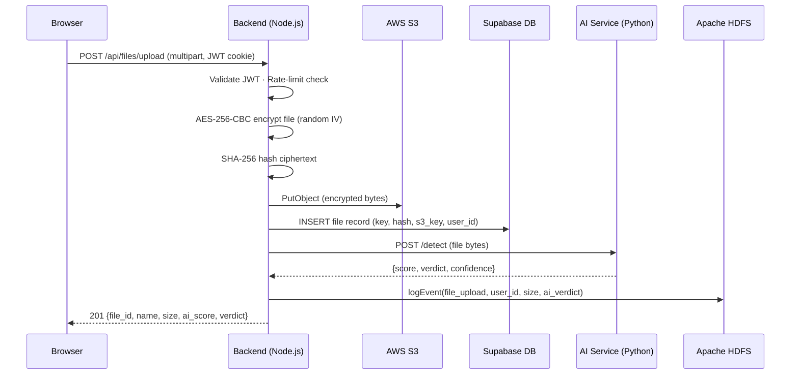
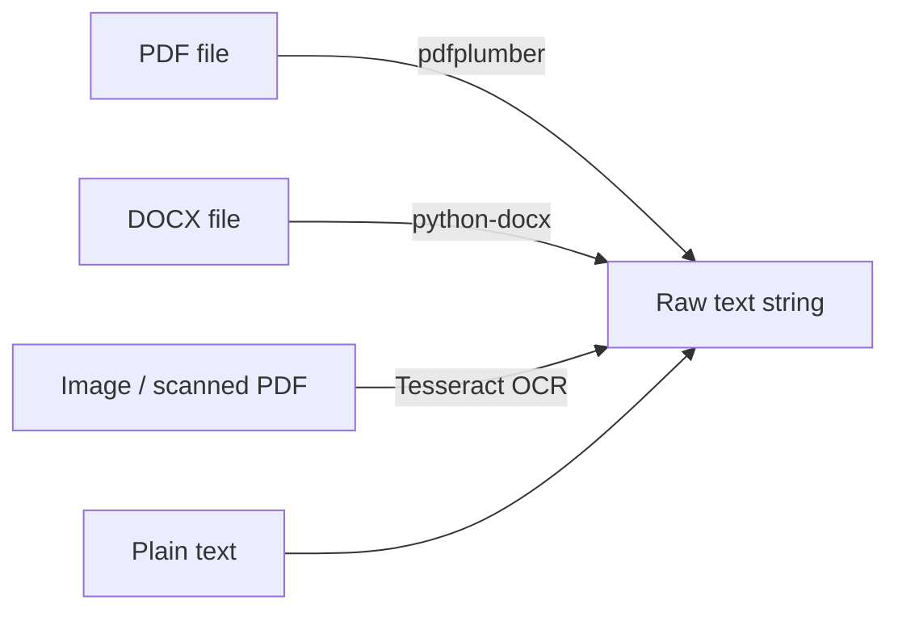
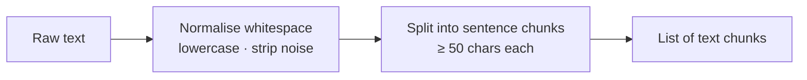
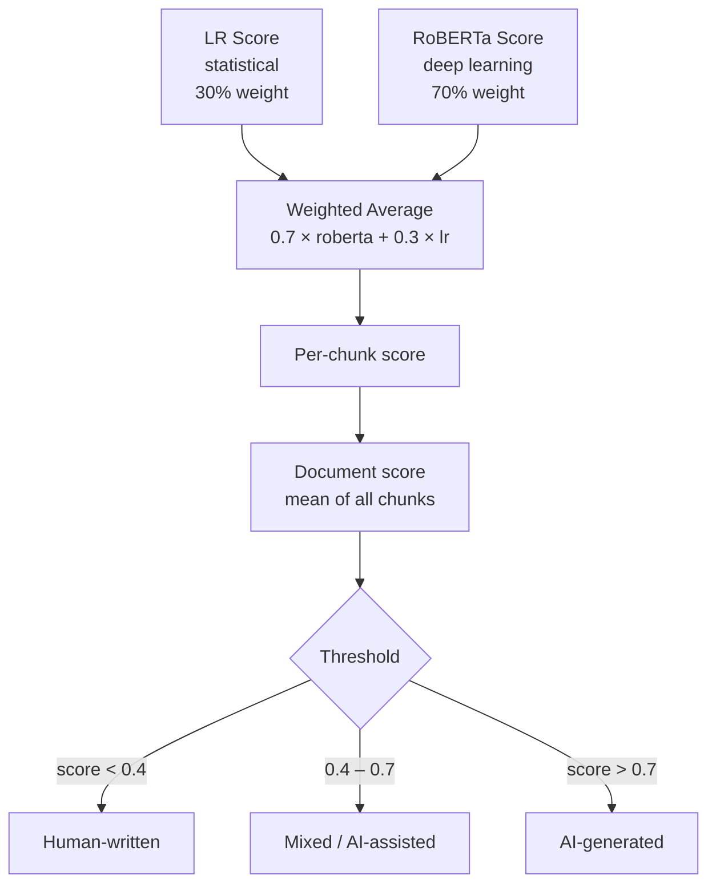
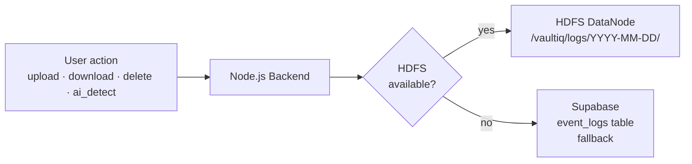
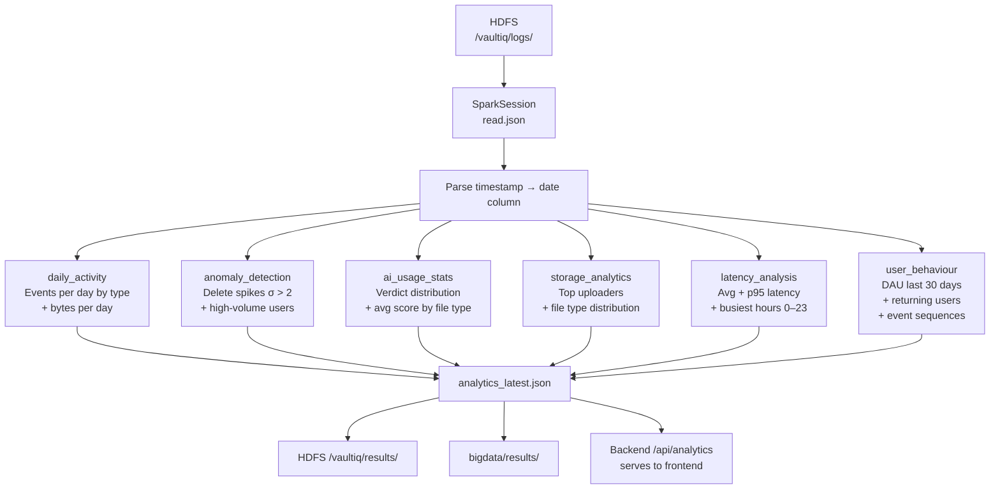
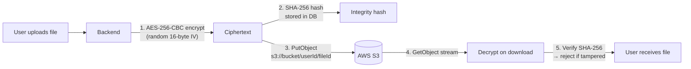
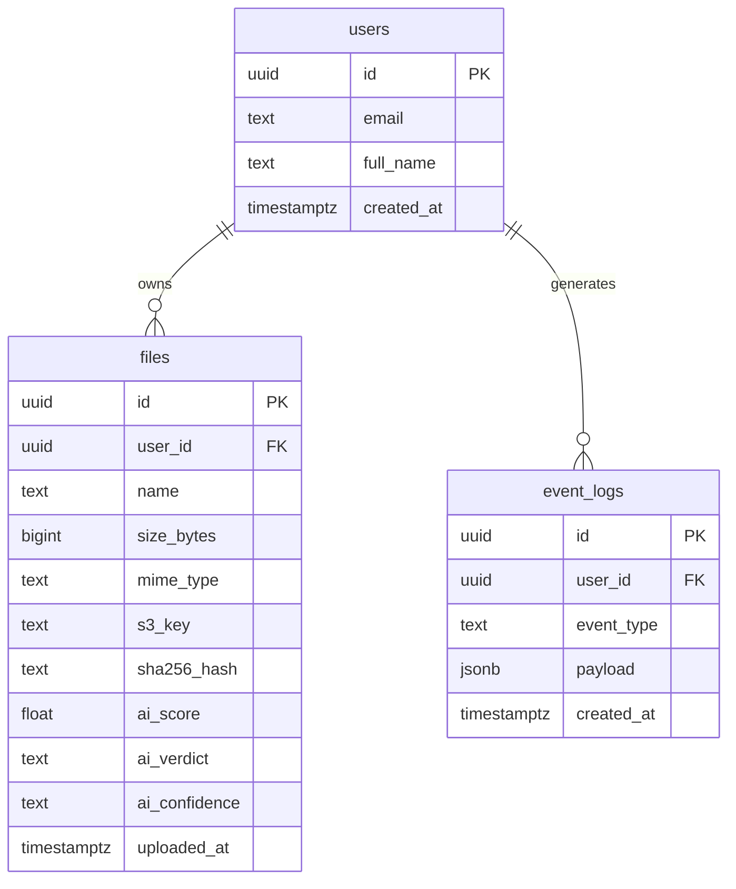
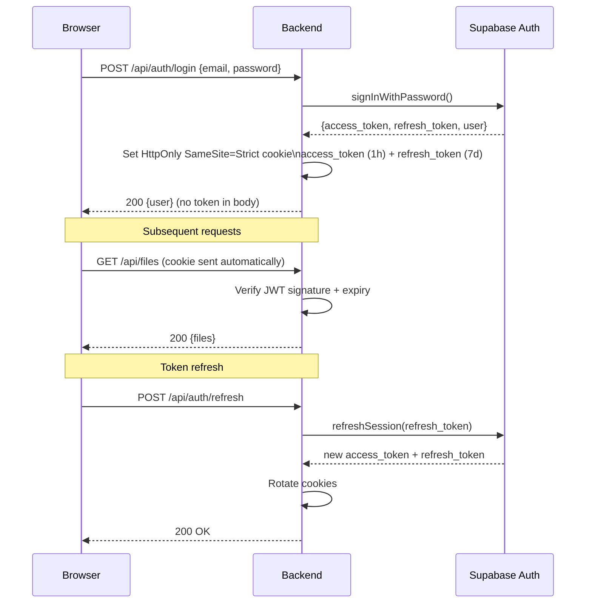

# VaultIQ

**Secure Distributed Cloud Storage with AI-Powered Document Intelligence**

[](https://nodejs.org/)
[](https://python.org/)
[](https://react.dev/)
[](https://spark.apache.org/)
[](https://aws.amazon.com/s3/)
[](LICENSE)

---

## What is VaultIQ?

VaultIQ is a full-stack, production-grade document storage platform built around three pillars:

1. **Security** — every file is AES-256-CBC encrypted before it leaves the browser's network; the server never stores plaintext.
2. **Intelligence** — a hybrid AI ensemble (RoBERTa deep learning + Logistic Regression on statistical features) detects whether uploaded documents contain AI-generated content.
3. **Observability** — every platform event is streamed to Apache HDFS and batch-processed by Apache Spark, producing six categories of analytics (daily activity, anomalies, AI usage, storage, latency, user behaviour).

---

## Table of Contents

- [System Architecture](#system-architecture)
- [Tech Stack](#tech-stack)
- [Project Structure](#project-structure)
- [AI Detection Deep-Dive](#ai-detection-deep-dive)
- [Big Data Pipeline Deep-Dive](#big-data-pipeline-deep-dive)
- [Cloud Infrastructure Deep-Dive](#cloud-infrastructure-deep-dive)
- [Security Model](#security-model)
- [Setup & Running](#setup--running)
- [API Reference](#api-reference)
- [Troubleshooting](#troubleshooting)

---

## System Architecture

VaultIQ is composed of four independently deployable services that communicate over HTTP/REST.

```
┌─────────────────────────────────────────────────────────────────────┐
│                          User Browser                               │
│                     React 19 SPA (port 3000)                        │
└───────────────────────────┬─────────────────────────────────────────┘
                            │  HTTPS / REST + JWT Cookie
                            ▼
┌─────────────────────────────────────────────────────────────────────┐
│                    Node.js / Express 5 Backend                      │
│                         (port 5000)                                 │
│                                                                     │
│  ┌──────────┐  ┌──────────┐  ┌──────────────┐  ┌───────────────┐  │
│  │  /auth   │  │  /files  │  │  /ai-detect  │  │  /analytics   │  │
│  └──────────┘  └────┬─────┘  └──────┬───────┘  └───────┬───────┘  │
└───────────────────── │ ─────────────│──────────────────│───────────┘
                       │             │                   │
          ┌────────────┼─────────────┘                   │
          │            │                                 │
          ▼            ▼                                 ▼
    ┌──────────┐  ┌──────────────────┐          ┌───────────────┐
    │  AWS S3  │  │  FastAPI AI Svc  │          │  Apache HDFS  │
    │ (files)  │  │   (port 8001)    │          │  (event logs) │
    └──────────┘  └──────────────────┘          └───────┬───────┘
                                                        │
                  ┌──────────────────────────────────── │ ────────┐
                  │           Supabase (PostgreSQL)      │         │
                  │  metadata · auth · fallback logs ◄───┘         │
                  └──────────────────────────────────────────────  ┘
                                                        │
                                                        ▼
                                               ┌─────────────────┐
                                               │  Apache Spark   │
                                               │  Batch Jobs     │
                                               │  (6 analytics)  │
                                               └─────────────────┘
```

### End-to-End Request Flow



---

## Tech Stack

### Frontend — React 19

| Package | Purpose | Why |
|---------|---------|-----|
| React 19 | UI framework | Virtual DOM diffing, hooks, concurrent mode |
| React Router 6 | Client-side routing | Declarative nested routes, no page reload |
| Axios | HTTP client | Interceptors for JWT cookie + error handling |
| Framer Motion | Animations | Smooth page transitions and micro-interactions |
| Tailwind CSS | Styling | Utility-first; no CSS naming conflicts |
| Recharts | Analytics charts | Composable chart components built on D3 |
| React Hot Toast | Notifications | Non-intrusive, accessible toast system |
| React Dropzone | File upload UX | Drag-and-drop with MIME-type validation |

**Why React?** Component-level encapsulation, large ecosystem, and the ability to co-locate state and UI logic. Concurrent rendering in React 19 keeps the UI responsive during heavy S3 upload progress updates.

### Backend — Node.js / Express 5

| Package | Purpose | Why |
|---------|---------|-----|
| Express 5 | HTTP server | Non-blocking I/O, minimal abstraction over Node's http |
| jsonwebtoken | Auth tokens | Stateless JWT; no server-side session storage |
| Helmet | Security headers | CSP, HSTS, X-Frame-Options, noSniff |
| express-rate-limit | Throttling | Per-route request windows to prevent abuse |
| AWS SDK v3 | S3 client | Streaming multipart uploads, presigned URLs |
| Supabase JS | DB client | PostgreSQL queries + RLS enforcement |
| Multer | File uploads | Buffered multipart parsing before encryption |
| Joi | Input validation | Schema-based request validation at the route level |
| Winston | Structured logging | JSON log output for production aggregation |

**Why Node.js?** I/O-bound workloads (S3 uploads, DB queries, AI service calls) run concurrently on the event loop without threads. JavaScript end-to-end reduces context switching for developers.

### AI Service — Python / FastAPI

| Package | Purpose |
|---------|---------|
| FastAPI | Async HTTP framework with auto-generated OpenAPI docs |
| PyTorch | Deep learning inference (RoBERTa, GPT-2) |
| HuggingFace Transformers | Pre-trained model loading (roberta-base-openai-detector) |
| Scikit-learn | Logistic Regression training + `joblib` serialisation |
| pdfplumber | PDF text extraction (layout-aware) |
| python-docx | DOCX paragraph extraction |
| Pytesseract | OCR for scanned images and image-based PDFs |
| NumPy | Feature vector construction |
| uvicorn | ASGI server (production) |

**Why Python?** De-facto standard for ML — PyTorch, HuggingFace, and scikit-learn have no equivalents in other ecosystems. FastAPI gives near-Express ergonomics with Python's async/await.

### Big Data — Apache Hadoop + Spark

| Component | Role |
|-----------|------|
| HDFS NameNode | Metadata server; tracks block locations |
| HDFS DataNode | Stores actual log file blocks |
| WebHDFS REST API | HTTP interface used by Node.js to write logs without Hadoop client |
| Apache Spark (master + worker) | Distributed computation for batch analytics |
| PySpark | Python API; analytics jobs written as pure DataFrame transformations |
| MapReduce fallback | Pure-Python fallback if Spark is unavailable |

### Cloud / Infrastructure

| Service | Role |
|---------|------|
| AWS S3 | Encrypted file object storage; infinitely scalable |
| Supabase (PostgreSQL 15) | File metadata, user auth, RLS policies, fallback event log |
| Docker Compose | Local orchestration of all 8 containers |
| Redis (optional) | Rate-limit state store in multi-instance deploys |

---

## Project Structure

```
vaultiq/
│
├── frontend/                        React SPA
│   └── src/
│       ├── pages/                   Route-level components
│       │   ├── Login.jsx            Sign-in with JWT cookie auth
│       │   ├── Signup.jsx           Registration + password strength meter
│       │   ├── Dashboard.jsx        File grid + upload zone
│       │   ├── FilesPage.jsx        File browser with search + sort
│       │   ├── Analytics.jsx        Recharts analytics dashboard
│       │   └── TextAiDetection.jsx  Paste-text AI detection UI
│       ├── components/              Shared UI components
│       │   ├── AIDetector.jsx       AI score badge + verdict display
│       │   ├── FileCard.jsx         Per-file card (name, size, hash, AI score)
│       │   ├── HashBadge.jsx        Truncated SHA-256 integrity badge
│       │   ├── UploadZone.jsx       Drag-and-drop upload dropzone
│       │   ├── AnalyticsDashboard.jsx  Recharts charts wrapper
│       │   └── ui/                  Primitive components (Button, Input, …)
│       ├── services/                Axios API layer (api.js, fileService.js)
│       ├── hooks/                   useAuth.js, useFiles.js
│       └── context/                 AuthContext.jsx (JWT state + refresh)
│
├── backend/                         Node.js / Express API
│   ├── server.js                    App bootstrap, middleware, rate limits
│   ├── routes/
│   │   ├── auth.js                  /api/auth (register, login, logout, refresh)
│   │   ├── files.js                 /api/files (upload, list, download, delete)
│   │   ├── aiDetection.js           /api/ai-detect (file + text detection)
│   │   └── analytics.js             /api/analytics (dashboard metrics, refresh)
│   ├── middleware/
│   │   ├── auth.js                  JWT authenticateToken middleware
│   │   ├── validate.js              Joi schema validation wrapper
│   │   └── requestId.js             UUID per request (X-Request-ID header)
│   ├── utils/
│   │   ├── crypto.js                AES-256-CBC encrypt/decrypt + SHA-256 hash
│   │   ├── s3.js                    PutObject / GetObject / DeleteObject wrappers
│   │   ├── hdfsLogger.js            Async WebHDFS log writer (Supabase fallback)
│   │   ├── supabase.js              Supabase client (anon + service key)
│   │   ├── logger.js                Winston structured logger
│   │   ├── emailService.js          Nodemailer for lockout/alert emails
│   │   └── accountLockout.js        5-strike lockout with TTL
│   ├── validators/                  Joi schemas for auth + file routes
│   ├── migrations/                  SQL migration files for Supabase
│   └── scripts/
│       ├── migrate.js               Run pending Supabase migrations
│       ├── migrate_pg.js            Direct PostgreSQL migration runner
│       └── spark-jobs/              Spark analytics scripts (submitted to cluster)
│           ├── analytics_job.py
│           ├── ai_trends.py
│           ├── storage_stats.py
│           └── usage_analytics.py
│
├── ai-service/                      Python FastAPI microservice
│   ├── main.py                      App entry, /health + /detect + /detect/text
│   ├── detector.py                  Ensemble orchestration (load, score, detect)
│   ├── extractor.py                 Text extraction (PDF, DOCX, images)
│   ├── preprocessor.py              Sentence chunking + normalisation
│   ├── statistical.py               5-feature statistical extractor
│   ├── ensemble.py                  Weighted score combiner
│   ├── similarity.py                Cosine/Jaccard/semantic corpus search
│   ├── similarity_ensemble.py       Similarity score aggregator
│   ├── train_lr.py                  Train/retrain the Logistic Regression model
│   ├── models/                      lr_model.pkl, tfidf.pkl (gitignored if large)
│   ├── datasets/corpus.csv          Reference corpus for similarity detection
│   └── tests/                       pytest unit tests per module
│
├── bigdata/                         PySpark batch analytics
│   ├── analytics_job.py             Main Spark job — 6 analytics functions
│   ├── mapreduce_fallback.py        Pure-Python fallback (no Spark required)
│   ├── run_analytics.sh             Shell orchestrator (submits to cluster)
│   ├── results/                     Output JSON (local + HDFS mirror)
│   └── tests/                       pytest for each analytics function
│
├── docs/
│   ├── api/backend-api.md           Full REST API reference
│   └── architecture/ai-detection.md AI pipeline technical specification
│
├── docker-compose.yml               Full 8-container stack definition
├── .env.example                     Environment variable template
├── hadoop.env                       Hadoop container env overrides
└── start.sh                         One-command local dev launcher
```

---

## AI Detection Deep-Dive

VaultIQ's AI content detector combines **deep learning** and **statistical analysis** into a weighted ensemble. The pipeline has five stages.

### Stage 1 — Text Extraction



`extractor.py` routes each file by extension to the correct parser. For images and scanned PDFs, Tesseract converts pixel content to Unicode text before the pipeline continues.

### Stage 2 — Preprocessing & Chunking



`preprocessor.py` breaks text into sentence-level chunks. Chunking is necessary because transformer models have a 512-token context limit; splitting enables per-chunk scoring and a more granular final distribution.

### Stage 3 — Statistical Feature Extraction (Component 1)

For each chunk, `detector.py → extract_features()` computes five numerical features:

| # | Feature | How it detects AI |
|---|---------|-------------------|
| 1 | **Perplexity** | GPT-2 cross-entropy loss over the chunk. LLMs produce low-perplexity (predictable) text that surprises GPT-2 less than human writing. |
| 2 | **Burstiness** | Variance of sentence lengths ÷ mean length. AI text has unusually uniform sentence lengths; humans vary more. |
| 3 | **Type-Token Ratio (TTR)** | Unique words ÷ total words. AI over-relies on a narrower, more repetitive vocabulary. |
| 4 | **Avg Sentence Length** | Mean word count per sentence. AI consistently produces mid-length sentences. |
| 5 | **Punctuation Density** | Punctuation chars ÷ total chars. AI uses punctuation more formulaically. |

These five features form a vector passed to the Logistic Regression model.

### Stage 4 — Deep Learning Score (Component 2)

```mermaid
flowchart TD
    Chunk[Text chunk] --> Tokenise[RoBERTa tokeniser\nmax 512 tokens]
    Tokenise --> Model[roberta-base-openai-detector\nfine-tuned by OpenAI]
    Model --> Softmax[Softmax over 2 classes\nReal · Fake]
    Softmax --> FakeProb[P(AI-generated)\n0.0 – 1.0]
```

`roberta-base-openai-detector` is a RoBERTa model fine-tuned by OpenAI on GPT-2 output. It learns **semantic and syntactic patterns** characteristic of language models — things that aren't captured by statistics alone (e.g., unnaturally coherent transitions, absence of lived experience).

### Stage 5 — Ensemble & Verdict



The **70/30 weighting** reflects that RoBERTa's semantic understanding generalises better than statistical heuristics, but the statistical features add independent signal for edge cases where the transformer is uncertain.

**Confidence is determined by chunk count:**
- `low` — fewer than 3 chunks (not enough evidence)
- `medium` — 3–5 chunks
- `high` — more than 5 chunks

**Similarity detection runs in parallel** using cosine similarity, Jaccard overlap, and a semantic embedding comparison against the reference corpus (`datasets/corpus.csv`), producing a separate `similarity_score` that flags potential plagiarism independently of AI detection.

### Model Training

`train_lr.py` trains the Logistic Regression on labeled data in `datasets/corpus.csv`. Features are extracted using the same `extract_features()` function used at inference time, ensuring no train/inference skew. The trained model is serialised with `joblib` to `models/lr_model.pkl`.

If `lr_model.pkl` is missing, the service falls back to a `DummyLR` (always returns 0.5) and sets `model_warning` in the response so the frontend can alert the user.

---

## Big Data Pipeline Deep-Dive

Every user action in VaultIQ generates a structured event log that feeds a distributed analytics pipeline built on Apache Hadoop and Apache Spark.

### Event Logging Architecture



`utils/hdfsLogger.js` writes each event as a JSON file to HDFS via the WebHDFS REST API. The path follows a date-partitioned layout (`/vaultiq/logs/YYYY-MM-DD/`) that Spark reads as a partitioned dataset. If WebHDFS is unreachable, the logger silently falls back to inserting the event into the `event_logs` table in Supabase.

**Event schema:**
```json
{
  "event_type":       "file_upload",
  "user_id":          "uuid",
  "filename":         "report.pdf",
  "file_size_bytes":  204800,
  "file_type":        "pdf",
  "ai_verdict":       "human",
  "ai_score":         0.12,
  "duration_ms":      342,
  "timestamp":        "2026-04-14T10:23:00Z",
  "ip":               "1.2.3.4"
}
```

### Spark Batch Analytics

`bigdata/analytics_job.py` is submitted to the Spark cluster (or run locally with `local[*]`). It reads all logs from HDFS, performs six independent aggregations, and writes a single `analytics_latest.json` result file back to HDFS and a local copy to `bigdata/results/`.



**Six analytics produced:**

| Function | What it computes |
|----------|-----------------|
| `daily_activity` | Per-day upload/download/AI-detection counts + total bytes |
| `anomaly_detection` | Delete spikes (mean + 2σ threshold) + users with >50 events/hour |
| `ai_usage_stats` | Verdict distribution (human/mixed/ai); avg AI score by file type |
| `storage_analytics` | Top 10 uploaders by bytes; file-type breakdown by count + size |
| `latency_analysis` | Average and p95 latency per event type; 24-hour activity heatmap |
| `user_behaviour` | DAU (last 30 days); returning users (>3 active days); event sequence patterns |

### MapReduce Fallback

`bigdata/mapreduce_fallback.py` provides a single-machine, pure-Python implementation of the same analytics using the built-in `collections.Counter` and `statistics` modules. It is invoked when the Spark cluster is unavailable, ensuring analytics are never silently absent.

### Docker Cluster (Hadoop + Spark)

```
namenode   ← HDFS NameNode + WebHDFS REST (port 9870)
datanode   ← HDFS DataNode (blocks)
spark-master ← Spark coordinator (port 8080, 7077)
spark-worker ← Spark executor (1 core / 1 GB)
```

The `backend/scripts/spark-jobs/` directory is volume-mounted into both Spark containers so jobs can be submitted with `spark-submit /opt/spark-jobs/analytics_job.py`.

---

## Cloud Infrastructure Deep-Dive

### AWS S3 — Encrypted Object Storage



- Files are stored under `{userId}/{fileId}` keys — no file from one user can be accessed by another even if S3 permissions were misconfigured, because the backend enforces `user_id` ownership before generating the S3 key.
- S3 server-side encryption (SSE-S3 or SSE-KMS) adds a second layer of encryption at rest on top of the application-level AES encryption.

### Supabase (PostgreSQL 15) — Metadata & Auth



Row-Level Security (RLS) is enabled on `files` and `event_logs`. All queries are automatically filtered to the authenticated user's `user_id` — a rogue query for another user's files returns 0 rows rather than an error, preventing enumeration attacks.

### Authentication Flow



Tokens are never exposed to JavaScript — `HttpOnly` prevents `document.cookie` access. `SameSite=Strict` blocks all cross-origin cookie transmission, eliminating CSRF without CSRF tokens.

### Docker Compose — Full Stack

Running `docker compose up -d` starts all 8 containers in dependency order:

```
postgres (db)
redis
ai-service     ─→  depends on: (none)
backend        ─→  depends on: db, redis, ai-service
namenode       ─→  formats HDFS on first boot
datanode       ─→  depends on: namenode (healthy)
spark-master
spark-worker   ─→  depends on: spark-master
```

The `frontend` is served separately during development (`npm start`). In production, an Nginx container serves the built React app and proxies `/api` to the backend.

---

## Security Model

| Layer | Mechanism | Protection |
|-------|-----------|------------|
| Transport | HTTPS / TLS (production) | Prevents eavesdropping |
| Auth | JWT in HttpOnly cookies | XSS cannot steal tokens |
| CSRF | SameSite=Strict + CORS whitelist | No CSRF tokens needed |
| File encryption | AES-256-CBC + random IV | Encrypted at rest in S3 |
| Integrity | SHA-256 hash verified on download | Detects tampering in S3 |
| RLS | Supabase row-level security | Queries scoped to `user_id` |
| Brute force | 5 strikes → 15-min lockout + email | Account takeover prevention |
| Rate limiting | Global (1000/15m), auth (10/15m), upload (100/hr), files (60/min) | DoS and abuse prevention |
| Input validation | Joi schemas on all routes | Rejects malformed requests early |
| Headers | Helmet (CSP, HSTS, X-Frame-Options, noSniff) | Browser-level protections |

---

## Setup & Running

### Prerequisites

- **Node.js** v18+
- **Python** 3.11+
- **Docker** (for Hadoop/Spark/Postgres containers)
- System packages: `brew install tesseract poppler ffmpeg` (macOS) or `apt-get install tesseract-ocr poppler-utils ffmpeg`

### 1. Clone & Install

```bash
git clone <repo-url> && cd vaultiq

# Frontend
cd frontend && npm install && cd ..

# Backend
cd backend && npm install && cd ..

# AI Service
python3 -m venv .venv
source .venv/bin/activate
pip install -r ai-service/requirements.txt
```

### 2. Environment Variables

```bash
cp backend/.env.example backend/.env
cp ai-service/.env.example ai-service/.env
```

**`backend/.env` — required variables:**

```env
# Security (generate with: node -e "console.log(require('crypto').randomBytes(32).toString('hex'))")
JWT_SECRET=<64-char-hex>
ENCRYPTION_KEY=<64-char-hex>

# Supabase
SUPABASE_URL=https://<project>.supabase.co
SUPABASE_ANON_KEY=eyJ...
SUPABASE_SERVICE_KEY=eyJ...

# AWS S3
AWS_ACCESS_KEY_ID=AKIA...
AWS_SECRET_ACCESS_KEY=...
AWS_REGION=us-east-1
S3_BUCKET_NAME=vaultiq-files

# Service config
PORT=5000
NODE_ENV=development
AI_SERVICE_URL=http://localhost:8001
HDFS_WEBHDFS_URL=http://localhost:9870/webhdfs/v1
HDFS_ENABLED=false          # set true when Hadoop is running
```

### 3. Database Migrations

In Supabase SQL Editor, run the migration files in order:

```
backend/migrations/000_database_rls_setup.sql
backend/migrations/001_add_indexes.sql
backend/migrations/002_setup.sql
backend/migrations/create_event_logs.sql
```

### 4. Run (All Services)

```bash
./start.sh
```

Or start individually:

```bash
# Terminal 1 — Frontend
cd frontend && npm start

# Terminal 2 — Backend
cd backend && npm run dev

# Terminal 3 — AI Service
source .venv/bin/activate
cd ai-service && uvicorn main:app --host 0.0.0.0 --port 8001 --reload

# Terminal 4 — Big Data Stack (optional)
docker compose up namenode datanode spark-master spark-worker -d
```

| Service | URL |
|---------|-----|
| Frontend | http://localhost:3000 |
| Backend API | http://localhost:5000 |
| AI Service | http://localhost:8001 |
| AI OpenAPI Docs | http://localhost:8001/docs |
| Hadoop NameNode UI | http://localhost:9870 |
| Spark Master UI | http://localhost:8080 |

### 5. Production (Docker)

```bash
docker compose up -d
```

---

## API Reference

### Health

```
GET  /api/health              Backend uptime + memory
GET  http://localhost:8001/health    AI service + model status
```

### Auth

```
POST /api/auth/register       { email, password, fullName }
POST /api/auth/login          { email, password }
POST /api/auth/logout
POST /api/auth/refresh
GET  /api/auth/me             (requires auth)
```

### Files

```
POST /api/files/upload        multipart/form-data, file field
GET  /api/files               list user files
GET  /api/files/:id/download  stream decrypted file
DELETE /api/files/:id
```

### AI Detection

```
POST /api/ai-detect           multipart, file field
POST /api/ai-detect-text      { text: "..." }
```

**Response:**
```json
{
  "data": {
    "score": 0.78,
    "verdict": "ai_generated",
    "confidence": "high",
    "chunk_scores": [0.82, 0.75, 0.76],
    "similarity_score": 0.012,
    "similarity_verdict": "low",
    "warning": null
  }
}
```

### Analytics

```
GET  /api/analytics           latest analytics (from HDFS results or DB)
POST /api/analytics/refresh   trigger Spark batch job
```

---

## Troubleshooting

**"Missing required environment variables"**
- Check `backend/.env` exists and all variables listed in `server.js` `REQUIRED_ENV` array are set.

**"AI models not loaded"**
- Activate the Python `.venv` before starting the AI service.
- Run `pip install torch transformers` if torch is missing.
- First start downloads ~500 MB of model weights from HuggingFace — allow 2–5 minutes.

**"S3 access denied"**
- Verify `AWS_ACCESS_KEY_ID` / `AWS_SECRET_ACCESS_KEY` and that the IAM role has `s3:GetObject`, `s3:PutObject`, `s3:DeleteObject` on the bucket.

**"HDFS connection refused"**
- Set `HDFS_ENABLED=false` in `.env` to use Supabase fallback logging.
- Or start the HDFS containers: `docker compose up namenode datanode -d` and wait for the NameNode healthcheck to pass.

**App shows blank page**
- Check browser console for errors.
- Confirm backend is running on port 5000 (`curl http://localhost:5000/api/health`).

---

## License

MIT — see [LICENSE](LICENSE)

---

**Version:** 1.0.0 | **Last Updated:** 2026-04-14
