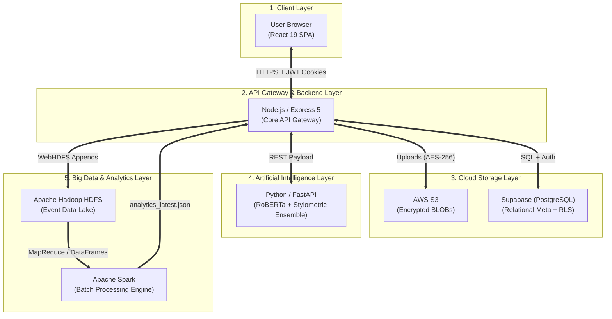
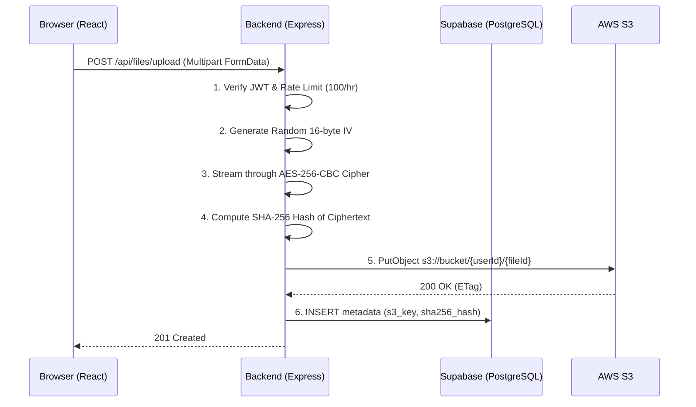
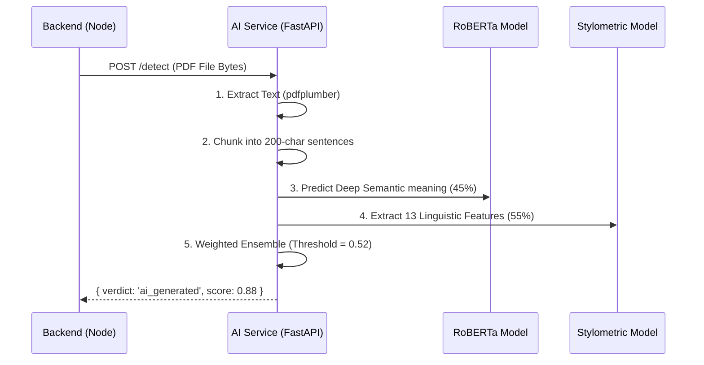
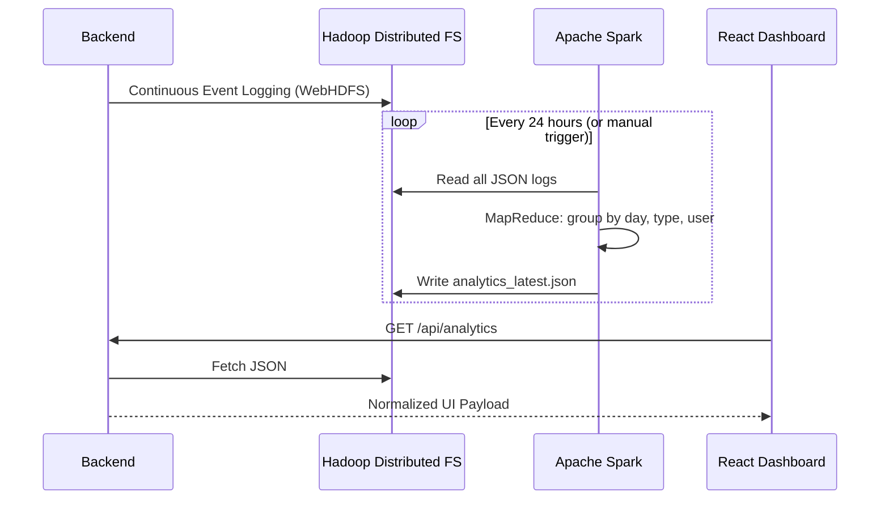

# VaultIQ — Secure Academic Workspace & AI Intelligence Platform

VaultIQ is a production-grade, full-stack educational platform that combines secure document management, Microsoft Forms-style public submission portals, deep-learning AI content detection, and a massive-scale Big Data analytics pipeline.

This document serves as the **Master Thesis** and comprehensive documentation for the entire project. It explains not just *how* to run the project, but the underlying **"teachinatics" (mechanics, concepts, and theories)** behind every architectural decision.

---

## 📑 Table of Contents
1. [Executive Summary & System Architecture](#1-executive-summary--system-architecture)
2. [End-to-End Data Flows](#2-end-to-end-data-flows)
3. [Frontend Deep-Dive (React & UI)](#3-frontend-deep-dive-react--ui)
4. [Backend Mechanics (Node.js & Express)](#4-backend-mechanics-nodejs--express)
5. [Cloud Infrastructure (Supabase & AWS S3)](#5-cloud-infrastructure-supabase--aws-s3)
6. [AI Detection Engine (FastAPI & PyTorch)](#6-ai-detection-engine-fastapi--pytorch)
7. [Big Data & Analytics Pipeline (Apache Spark & Hadoop)](#7-big-data--analytics-pipeline-apache-spark--hadoop)
8. [Setup, Deployment & DevOps](#8-setup-deployment--devops)

---

## 1. Executive Summary & System Architecture

VaultIQ is designed as a **Service-Oriented Architecture (SOA)**, breaking down complex educational workflows into four independent, highly-specialized components. 

### Master Architecture Diagram



### The "Why" Behind the Stack
- **Node.js (Backend):** JavaScript's event-loop excels at I/O-heavy operations (streaming files to S3, waiting for Database queries, calling Python APIs) without blocking the thread.
- **Python (AI):** The undisputed king of Machine Learning. We use `PyTorch` and `Transformers` because they have no native equivalent in the Node.js ecosystem.
- **React (Frontend):** Concurrent rendering in React 19 keeps the UI perfectly smooth even while large 50MB files are streaming uploads in the background.
- **Spark & Hadoop (Data):** While a standard PostgreSQL DB works for thousands of rows, analyzing millions of granular application logs requires distributed computing (MapReduce).

---

## 2. End-to-End Data Flows

Understanding VaultIQ requires understanding its three primary "Loops".

### Flow A: The File Upload & Encryption Loop
When a student submits a file, it must be protected from tampering and unauthorized access.

**The Mechanics:** We use **Symmetric Encryption (AES-256-CBC)**. The file is encrypted *before* it leaves the Node.js server. If someone hacks the AWS S3 bucket, they will only find meaningless scrambled bytes. We also save a **SHA-256 Hash**, so when the file is downloaded, we can verify that a single byte hasn't been altered (Integrity).

### Flow B: The AI Detection Loop
How we catch AI-generated cheating.


### Flow C: The Big Data Analytics Loop
How we turn chaotic logs into beautiful UI charts.


---

## 3. Frontend Deep-Dive (React & UI)

The frontend is built with **React 19, TailwindCSS, and Recharts**.

### State Management & The Auth Context
**Concept:** Authentication should be stateless on the server, but persistent on the client.
**Mechanics:** VaultIQ uses a dual-token system.
- `access_token`: Valid for 1 hour.
- `refresh_token`: Valid for 7 days.
Both are stored as `HttpOnly` cookies. The React `AuthContext` holds a memory state `isAuthenticated`. When a request fails with `401 Unauthorized`, an **Axios Interceptor** catches the error, pauses the request, silently hits `/api/auth/refresh`, and then replays the original request so the user never notices they were logged out.

### UI Design System & Component Encapsulation
VaultIQ doesn't use massive, messy CSS files. It uses **TailwindCSS** utility classes composed into reusable primitive components (`Button.jsx`, `StatCard.jsx`). 
- **Theming:** Colors are defined via CSS variables (`--viq-bg`, `--viq-text`) allowing instant light/dark mode toggling.
- **Analytics Charts:** Using `Recharts`, complex SVG paths are rendered declaratively. We explicitly map the Spark DataFrames (e.g., `ai_verdict_counts`) to specific vivid colors (e.g., `#60A5FA` for Human, `#F472B6` for AI).

---

## 4. Backend Mechanics (Node.js & Express)

The backend acts as the secure traffic cop of the application.

### The Request Lifecycle
1. **Helmet & CORS:** Sets security headers preventing Clickjacking and XSS.
2. **Rate Limiting:** Prevents Brute Force attacks. (e.g., You can only hit `/login` 10 times in 15 minutes).
3. **Cookie Parser:** Extracts the JWT from the secure cookie.
4. **Multer:** Handles `multipart/form-data` (file uploads). Instead of saving the file to the local disk (which crashes servers at scale), Multer buffers the file in RAM.
5. **Joi Validation:** Ensures the request body matches exactly what the database expects.

### Supabase Row-Level Security (RLS)
**Concept:** The database should protect itself, even if the backend is compromised.
**Mechanics:** In PostgreSQL, we run commands like:
```sql
CREATE POLICY "Users can only view their own files" ON files 
FOR SELECT USING (auth.uid() = user_id);
```
When Node.js queries the database, it passes the user's JWT directly to PostgreSQL. PostgreSQL evaluates the JWT, extracts the `user_id`, and *physically drops* any rows that don't belong to that user before returning the response.

---

## 5. AI Detection Engine (FastAPI & PyTorch)

This is the brain of the operation, combining two distinct forms of machine learning into a Hybrid Ensemble.

### Model 1: Stylometric Machine Learning (The Math)
**Concept:** Humans write messily; AIs write mathematically perfectly. We can measure this "perfection" using Statistics.
**Mechanics:** We extract 13 features from every sentence, including:
- **Burstiness:** The mathematical variance in sentence length. (AI sentences are uniformly long; humans write short. Then long. Then short.)
- **Perplexity:** How "surprised" a language model is by the text. (If GPT-2 easily predicts the next word, an AI probably wrote it).
- **Type-Token Ratio (TTR):** Number of unique words divided by total words. AI has a narrow, highly-optimized vocabulary.

These 13 numbers are fed into a `HistGradientBoostingClassifier`, which uses Decision Trees to output a probability (0.0 to 1.0) that the text is AI.

### Model 2: RoBERTa Deep Learning (The Semantic Understanding)
**Concept:** Sometimes stats aren't enough. We need a model that actually "reads" the context.
**Mechanics:** We use `roberta-base-openai-detector`, a Transformer neural network with 125 million parameters. It converts words into "Tensors" (multi-dimensional arrays of numbers), passes them through 12 layers of "Attention Mechanisms" to understand the syntax, tone, and coherence, and outputs a probability.

### The Isotonic Ensemble
If RoBERTa says 90% AI, but Stylometry says 40% AI, who wins?
We use **Isotonic Calibration** to ensure both models output true probabilities, then we blend them using empirically tuned weights (45% RoBERTa, 55% Stylometry). If the final blended score crosses `0.52`, the text is flagged as cheating.

---

## 6. Big Data & Analytics Pipeline (Apache Spark & Hadoop)

As thousands of students submit files, relational databases (SQL) choke on the millions of resulting log events. VaultIQ uses Big Data concepts to solve this.

### The Data Lake (HDFS)
**Concept:** Store data as simple, append-only text files distributed across many hard drives.
**Mechanics:** Every time a user clicks a button, Node.js fires an HTTP request to `WebHDFS`. The event is appended to a JSON file partitioned by date (e.g., `/vaultiq/logs/2026-05-20/`). 

### The MapReduce Engine (Apache Spark)
**Concept:** Move the code to the data, not the data to the code.
**Mechanics:** PySpark (`analytics_job.py`) loads all these JSON files into a massively parallel `DataFrame`. Instead of a standard SQL `GROUP BY`, Spark distributes the counting task across multiple "Worker" containers.
1. **Mapping:** Each worker looks at a chunk of logs and extracts `{ date: 'May 20', events: 1 }`.
2. **Reducing:** The Master node adds up all the workers' results to get the total daily events.
The output is saved as a single highly-compressed file: `analytics_latest.json`.

### High-Availability (3-Tier Read Strategy)
If the Hadoop cluster crashes, the frontend must not break.
1. **Tier 1:** Ask HDFS for `analytics_latest.json`.
2. **Tier 2 (Fallback 1):** Check the local disk for a cached version.
3. **Tier 3 (Fallback 2):** Bypass Hadoop entirely and query the raw Supabase `event_logs` table.

---

## 7. Setup, Deployment & DevOps

VaultIQ uses **Docker Compose** to orchestrated 8 different microservices, ensuring that what runs on your laptop runs exactly the same on an AWS server.

### Prerequisites
- Node.js v18+
- Python 3.11+
- Docker & Docker Compose

### 1. Environment Configuration
Create a `.env` file in the `backend/` directory:
```env
PORT=5000
JWT_SECRET=<random-64-char-string>
ENCRYPTION_KEY=<random-64-char-string>
SUPABASE_URL=https://<your-project>.supabase.co
SUPABASE_ANON_KEY=<your-key>
SUPABASE_SERVICE_KEY=<your-key>
AWS_ACCESS_KEY_ID=<your-aws-key>
AWS_SECRET_ACCESS_KEY=<your-aws-secret>
S3_BUCKET_NAME=vaultiq-files
AI_SERVICE_URL=http://localhost:8001
HDFS_WEBHDFS_URL=http://localhost:9870/webhdfs/v1
```

### 2. Database Migrations (Supabase)
Navigate to your Supabase SQL Editor and run the files in `backend/migrations/` in sequential order to set up the tables, Foreign Keys, and RLS policies.

### 3. Launching the Cluster
Run the provided bootstrap script:
```bash
./start.sh
```
This script will:
1. Boot the PostgreSQL and Redis containers.
2. Boot the Hadoop NameNode and DataNode.
3. Boot the Spark Master and Workers.
4. Launch the FastAPI AI Service on port `8001`.
5. Launch the Node.js API Gateway on port `5000`.
6. Launch the React Frontend on port `3000`.

### Production Deployment (AWS / Vercel)
For production, the recommended architecture is:
- **Frontend:** Vercel (Auto-deploys via Git Push).
- **Backend & AI:** AWS Elastic Beanstalk or AWS ECS (Docker containers).
- **Big Data:** AWS EMR (Elastic MapReduce) replacing local Hadoop.
- **Database:** Hosted Supabase.

---
**VaultIQ Version:** 2.0.0
**Architect:** Developed for Secure Academic Environments.
