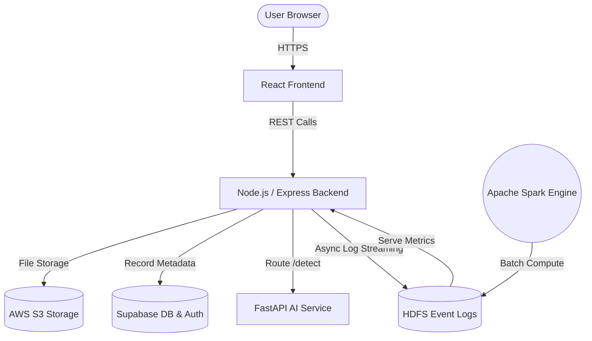
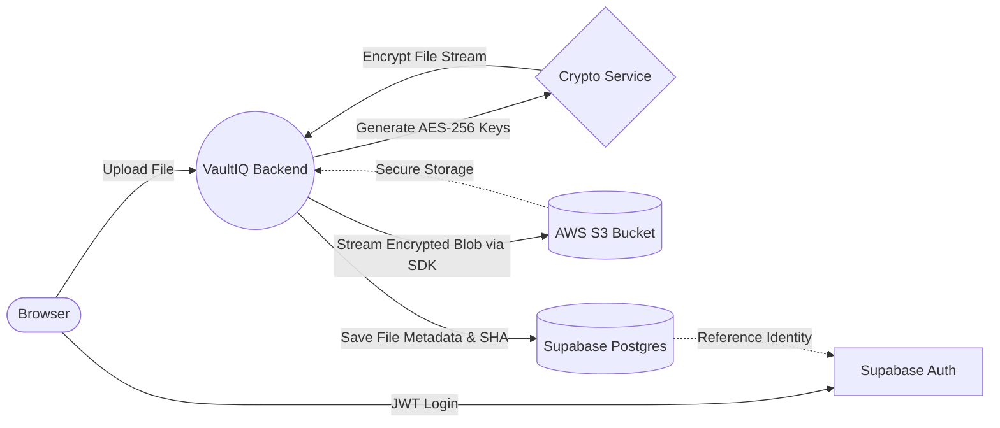
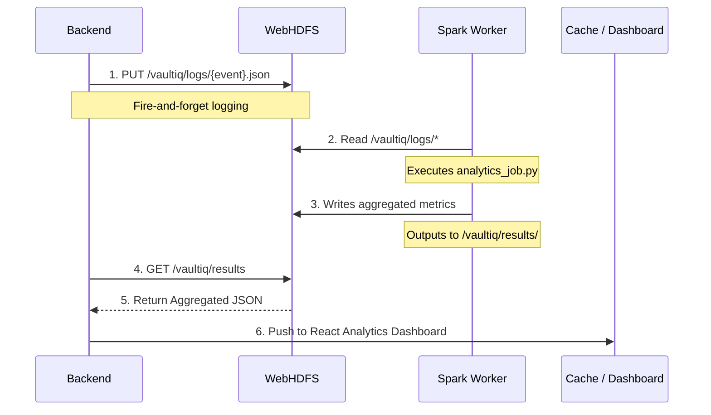
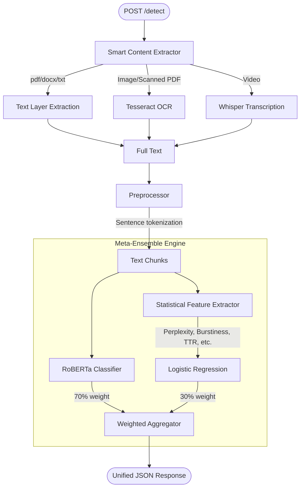

# VaultIQ — Secure Distributed Cloud Storage System

VaultIQ is a production-grade, full-stack document storage platform designed for the highest levels of security, data integrity, and system observability. 

It provides end-to-end AES-256 encryption, AI-powered predictive document analysis (plagiarism and AI-content detection), and a robust Big Data analytics pipeline structured on Apache Hadoop and Spark.

---

## Table of Contents

1. [Overview & Detailed Explanation](#overview--detailed-explanation)
2. [Architecture Flowcharts](#architecture-flowcharts)
    - [Overall System Flow](#1-overall-system-flow)
    - [Cloud Infrastructure Flow](#2-cloud-infrastructure-flow)
    - [Big Data Pipeline Flow](#3-big-data-pipeline-flow)
    - [AI Processing Flow](#4-ai-processing-flow)
3. [Features](#features)
4. [Tech Stack](#tech-stack)
5. [Project Structure](#project-structure)
6. [Prerequisites](#prerequisites)
7. [Environment Setup](#environment-setup)
8. [How to Run](#how-to-run)
9. [API Reference](#api-reference)
10. [Security Model](#security-model)

---

## Overview & Detailed Explanation

VaultIQ extends the traditional cloud storage paradigm by ensuring zero compromise on data security and adding intelligent document capabilities. Every file uploaded to the platform undergoes a rigorous process: it is first encrypted with a unique, randomized AES-256-CBC IV, signed with a SHA-256 integrity hash, and securely persisted in an AWS S3 Vault. The system is designed such that not even server administrators can decipher the file contents without the application decryption flow.

In addition to storage, VaultIQ supports **AI Document Integrity**. We have baked an intelligent microservice (written in Python/FastAPI) that assesses if an uploaded document is plagiarized or written by generative AI. It leverages a combination of state-of-the-art NLP models:
- **Plagiarism Detection**: Uses SBERT (Sentence-BERT) embeddings coupled with FAISS (Facebook AI Similarity Search) to perform rapid semantic similarity comparisons across billions of vectors.
- **AI-Content Detection**: Implements a Random Forest classifier trained on 7 distinct statistical features derived from the GPT-2 model (like perplexity, burstiness, and Shannon entropy) to measure how likely a text was written by an LLM.

To monitor the scale and usage of the platform, the **Big Data Analytics** pipeline automatically ships fire-and-forget system event logs asynchronously to an Apache Hadoop Distributed File System (HDFS). Nightly or on-demand Apache Spark batch jobs reduce these logs into highly digestible metric objects which map directly back into the live React dashboard.

---

## Architecture Flowcharts

### 1. Overall System Flow
This diagram illustrates the high-level request lifecycle across the entire VaultIQ stack.



### 2. Cloud Infrastructure Flow
Focuses on how files and authentication are handled securely via Cloud services.



### 3. Big Data Pipeline Flow
Details the fault-tolerant asynchronous logging to Hadoop and aggregation using Spark.



### 4. AI Processing Flow
The internal mechanics of the `ai-service` predicting document origins.



---

## Features

| Feature | Description |
|---|---|
| **Secure Authentication** | Email + password auth via Supabase; JWT stored in `HttpOnly SameSite=Strict` cookies; automatic token rotation. |
| **Account Lockout 防雷** | 5 failed logins triggers a 15-min lockout mechanism. |
| **Encrypted File Vault** | End-to-end AES-256-CBC encryption per file, SHA-256 mapping for high integrity assurance; piped securely into AWS S3. |
| **Multimodal Extraction** | Smart extraction of text from PDFs, DOCX, TXT, Images (OCR), and Videos (Whisper transcription). |
| **AI Content Scanner** | Hybrid ensemble (RoBERTa + Logistic Regression) measuring perplexity, burstiness, and structural nuances to detect LLM content. |
| **Big Data Analytics** | 7 key Spark analytic endpoints running securely over HDFS logs (trends, top lists, anomalies). |
| **Fault Tolerance** | Safe fallback mechanisms for all infrastructure tiers, including DB-based event logs if HDFS experiences downtime. |

---

## Tech Stack

### Frontend
- React 19, React Router 6, Axios
- Recharts, React Dropzone, Hot Toast

### Core Backend 
- Node.js, Express 5 
- `jsonwebtoken`, `helmet`, `express-rate-limit`
- Supabase JS API, AWS SDK v3 (`@aws-sdk/client-s3`)

### AI Microservice
- Python 3.11, FastAPI
- HuggingFace Transformers (`roberta-base-openai-detector`, `gpt2`)
- Pytesseract (OCR), OpenAI Whisper (Transcription)
- Scikit-Learn, Joblib

### Infrastructure / Big Data Deployments
- Supabase (PostgreSQL 15)
- AWS S3
- Apache Hadoop 3 (HDFS)
- Apache Spark 3
- Docker / Docker Compose orchestration

---

## Project Structure

```
vaultiq/
├── frontend/                    # React application
│   ├── src/                     # UI components, API hooks, Route pages
│   └── nginx.conf               # Web proxy bindings
│
├── backend/                     # Node.js Express API
│   ├── routes/                  # Express controllers 
│   ├── migrations/              # Supabase DB Schemas and Table designs
│   ├── scripts/                 # PySpark / JS Jobs
│   ├── utils/                   # Crypto / HDFS / S3 wrappers
│   └── server.js                # Core API bootstrap
│
├── ai-service/                  # Python FastAPI AI microservice
│   ├── models/                  # ML architectures (Logistic Regression, Pickles)
│   ├── training/                # Dataset management and model training
│   ├── main.py                  # API routes for ML inference
│   └── detector.py              # Ensemble scoring logic
│
├── bigdata/                     # MapReduce fallback and Hadoop dependencies
├── docker-compose.yml           # Full infrastructure orchestration file
|── AI_DETECTION_FLOW.md         # Detailed AI Technical Specs
└── start.sh                     # Start the full stack on local architectures
```

---

## Prerequisites

- Base Requirements: Node.js (v18+), Python (v3.11+)
- OS Dependencies: `tesseract-ocr`, `poppler-utils`, `ffmpeg` (for OCR & Transcriptions)
- Infrastructure Needs: Docker (+ Docker Compose), AWS S3 Bucket, Supabase instance keys.

---

## Environment Setup

### 1. Configure the `.env` dependencies

You must configure two independent keysets:
```bash
# Copy templates
cp backend/.env.example backend/.env
cp ai-service/.env.example ai-service/.env
```

### 2. Populate environment configurations

Modify `backend/.env`:
```env
# Encryption keys - Generate using crypto.randomBytes(32).toString('hex')
ENCRYPTION_KEY=<64-char-random-string>
JWT_SECRET=<64-char-random-string>

# Platform APIs
SUPABASE_URL=...
SUPABASE_ANON_KEY=...
SUPABASE_SERVICE_KEY=...

# Cloud Hosting
AWS_ACCESS_KEY_ID=...
AWS_SECRET_ACCESS_KEY=...
AWS_REGION=...
S3_BUCKET_NAME=...

# AI Service
AI_SERVICE_URL=http://localhost:8000
```

### 3. Setup the Database Schema
In Supabase SQL Editor, run the scripts placed inside `backend/migrations/` sequentially (000, 001, 002) to build the requisite structures for tracking analytics, login activity, and Row-Level security mappings.

---

## How to Run

### Local Architecture Execution
Leverages Python and Node independently for fluid development speed without the weight of containers.
```bash
# Bootstraps Backend, Frontend, and AI Service
./start.sh
```
- Frontend bound to [http://localhost:3000](http://localhost:3000)
- Backend bound to [http://localhost:5000](http://localhost:5000)
- AI Service Docs bound to [http://localhost:8000/docs](http://localhost:8000/docs)

### Full Scale Production Simulation (Docker Context)
Use this option when you want to spin up the entire cluster inclusive of HDFS datanodes and Spark workers.

```bash
docker compose up -d
```
Then configure your Node.js application `HDFS_ENABLED=true` within the `.env`.

---

## API Reference

A highly secured proxy environment interfaces with internal domains. JWT Auth relies exclusively on HttpOnly/SameSite secured storage patterns.

- `POST /api/auth/register`
- `POST /api/auth/login`
- `POST /api/files/upload` - Multipart ingestion and encryption
- `GET /api/files` - Decrypted byte retrieval
- `POST /api/ai-detect/` - Forwards to AI Service for deep content analysis
- `GET /api/analytics` - Extracts daily HDFS insights

---

## Security Model

The security of VaultIQ is deterministic from end-to-end:
1. **At Rest**: Object persistence is completely detached from original bytes by prepending an AES-256 block structure uniquely derived from a localized cryptographic seed. 
2. **In Motion**: Data flow mandates TLS terminating HTTPS. No telemetry or analytics metrics emit identifiable context regarding internal database associations.
3. **Session State**: Refresh tokens operate sequentially. We drop state automatically inside memory when sessions expire. Cross-site script exploits are avoided entirely via strictly enforcing browser restrictions utilizing `HttpOnly` cookie constraints.
