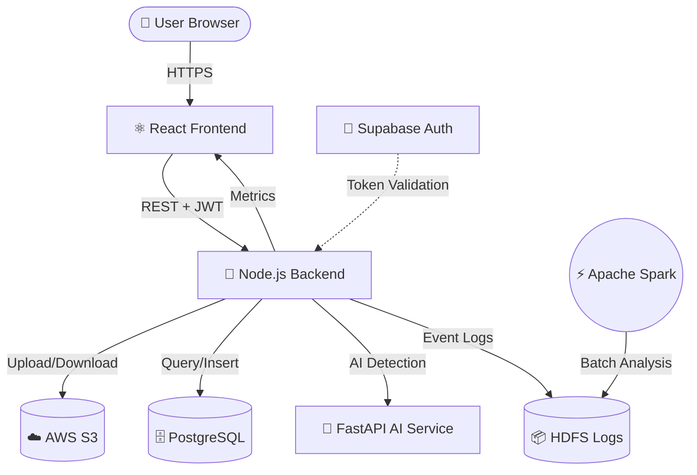
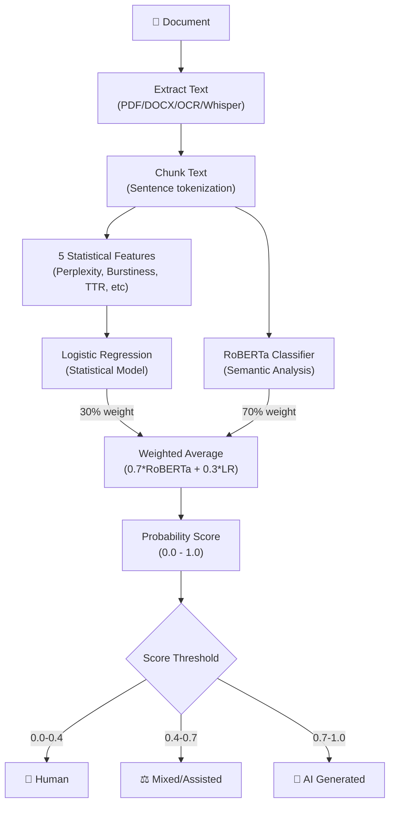

# VaultIQ — Secure Distributed Cloud Storage with AI-Powered Document Analysis


---

## 🎯 Overview

**VaultIQ** is a production-grade, full-stack document storage platform designed for the highest levels of security, data integrity, and system observability. It provides:

- **🔒 End-to-End Encryption**: AES-256-CBC encryption for every file with zero-knowledge architecture
- **🤖 AI-Powered Detection**: Hybrid ensemble (RoBERTa + Logistic Regression) to detect AI-generated content
- **📊 Big Data Analytics**: Apache Hadoop/Spark pipeline for real-time insights
- **🌐 Cloud-Native**: AWS S3, Supabase PostgreSQL, and HDFS integration
- **🔐 Enterprise Security**: JWT auth, rate limiting, account lockout, CORS, helmet headers
- **📱 Multimodal Processing**: Extract text from PDFs, DOCX, images (OCR), and videos (Whisper)

**Perfect for**: Organizations that need secure document storage with intelligent AI content analysis and compliance-ready audit trails.

---

## 🏗️ Architecture Overview



---

## ✨ Key Features

| Feature | Description | Why It Matters |
|---------|-------------|----------------|
| **🔓 Zero-Knowledge Encryption** | Files encrypted with AES-256-CBC; server never sees plaintext. Each file has unique IV + SHA-256 integrity hash. | Ensures even if database is compromised, files remain unreadable. |
| **🤖 AI Content Detection** | Hybrid ensemble combining RoBERTa deep learning + statistical LR model. Detects ChatGPT, Claude, and GPT-4 generated content. | Critical for academic integrity, content verification, and compliance. |
| **📄 Smart Extraction** | Automatically extracts text from PDFs (pdfplumber), DOCX (python-docx), images (Tesseract OCR), videos (OpenAI Whisper). | One-click upload works with any document format. |
| **🔐 Account Security** | 5-failed-login lockout (15 min), JWT rotation (1h access / 7d refresh), HttpOnly SameSite=Strict cookies. | Prevents brute force, credential theft, and CSRF attacks. |
| **📊 Big Data Analytics** | Real-time event logging to HDFS, nightly Spark aggregation jobs compute 7+ metrics (uploads, avg file size, peak hours, etc.). | Monitor platform usage, detect anomalies, usage trends. |
| **⚡ Rate Limiting** | Global (1000/15min), auth (10/15min), upload (100/hr), file ops (60/min). | Prevents abuse and ensures fair resource allocation. |
| **✅ Fault Tolerance** | HDFS logs fall back to Supabase if WebHDFS is down. Spark jobs handle missing files gracefully. | Service remains operational even if one component fails. |

---

## 🛠️ Tech Stack & Why We Chose It

### **Frontend**
- **React 19** — Modern, declarative UI framework with hooks and optimal performance
- **React Router 6** — Client-side routing without page reloads
- **Axios** — Promise-based HTTP client with interceptors for auth
- **Recharts** — Composable React components for analytics dashboards
- **React Dropzone** — Drag-and-drop file uploads with validation
- **Hot Toast** — Non-intrusive success/error notifications

**Why React?** Component reusability, large ecosystem, performance optimizations (virtual DOM), and unmatched tooling.

### **Backend**
- **Node.js + Express 5** — Non-blocking I/O, JavaScript end-to-end, fast HTTP server
- **JWT (jsonwebtoken)** — Stateless authentication, no session storage needed
- **Helmet** — Security HTTP headers (CSP, X-Frame-Options, noSniff, etc.)
- **express-rate-limit** — Middleware for request throttling
- **AWS SDK v3** — Official S3 client with streaming support
- **Supabase JS Client** — PostgreSQL access with built-in auth integration

**Why Node.js?** Single language (JS/TS), non-blocking for I/O-heavy ops (S3 uploads), and rich package ecosystem.

### **AI Microservice**
- **Python 3.11 + FastAPI** — Async Python framework, Pydantic validation, auto-generated OpenAPI docs
- **PyTorch + HuggingFace Transformers** — State-of-the-art NLP models (RoBERTa, GPT-2)
- **Scikit-Learn** — Machine learning library for logistic regression training
- **pdfplumber, python-docx** — PDF and DOCX text extraction
- **Tesseract OCR + Pillow** — Image text recognition
- **OpenAI Whisper** — Audio transcription (supports 99 languages)

**Why Python for AI?** De-facto standard for ML/NLP, massive ecosystem (NumPy, Pandas, scikit-learn), and best community support.

### **Infrastructure**
- **Supabase (PostgreSQL 15)** — Open-source Firebase alternative, real-time updates, row-level security
- **AWS S3** — Infinitely scalable object storage, versioning, encryption at rest
- **Apache Hadoop 3** — Distributed file system for audit logs, HDFS WebHFS API
- **Apache Spark** — Parallel computing engine for analytics jobs
- **Docker Compose** — Orchestrate multi-container deployment (local dev + production)

**Why this stack?** Industry-standard tools with battle-tested reliability, mature ecosystems, and easy scaling.

---

## 📦 Project Structure

```
vaultiq/
├── README.md                           # This file
├── CLAUDE.md                           # Claude Code integration guide
├── .env.example                        # Environment variables template
├── docker-compose.yml                  # Full stack orchestration
│
├── frontend/                           # React SPA
│   ├── src/
│   │   ├── components/                 # Reusable UI components
│   │   ├── pages/                      # Route pages (Login, Dashboard, etc)
│   │   ├── api/                        # API integration (Axios)
│   │   ├── hooks/                      # Custom hooks (useAuth, useFiles)
│   │   └── styles/                     # Global CSS + modules
│   ├── public/                         # Static assets
│   └── package.json
│
├── backend/                            # Node.js Express API
│   ├── server.js                       # Express app entry point
│   ├── middleware/                     # Auth, validation, logging
│   ├── routes/                         # Endpoint handlers
│   ├── utils/                          # Crypto, S3, HDFS, logger
│   ├── migrations/                     # Supabase SQL migrations
│   └── package.json
│
├── ai-service/                         # Python FastAPI microservice
│   ├── main.py                         # FastAPI app + routes
│   ├── detector.py                     # AI ensemble scoring logic
│   ├── similarity.py                   # Plagiarism detection
│   ├── extractor.py                    # Multimodal text extraction
│   ├── preprocessor.py                 # Text normalization
│   ├── models/                         # Trained LR model, TF-IDF vectorizer
│   ├── datasets/                       # Corpus for similarity search
│   ├── requirements.txt                # Python dependencies
│   └── train_lr.py                     # LR model training script
│
├── bigdata/                            # Big Data analytics
│   ├── analytics_job.py                # Spark job (Hadoop aggregation)
│   ├── mapreduce_fallback.py           # Fallback if Spark unavailable
│   ├── run_analytics.sh                # Job orchestrator
│   └── requirements.txt                # PySpark deps
│
├── docs/                               # Documentation
│   ├── architecture/
│   │   └── ai-detection.md             # AI pipeline technical spec
│   ├── api/
│   │   └── backend-api.md              # Backend API reference
│   └── superpowers/                    # Claude Code sessions
│
└── start.sh                            # Multi-service orchestrator
```

---

## 📋 Prerequisites

### **System Requirements**
- **OS**: macOS, Linux, or WSL2 (Windows)
- **Node.js**: v18 or higher ([download](https://nodejs.org/))
- **Python**: v3.11 or higher ([download](https://www.python.org/))
- **Docker** (optional, for full stack): [download](https://www.docker.com/)

### **System Dependencies**
Install using your package manager:

```bash
# macOS
brew install tesseract poppler ffmpeg

# Ubuntu/Debian
sudo apt-get install tesseract-ocr poppler-utils ffmpeg

# Fedora/RHEL
sudo dnf install tesseract poppler-utils ffmpeg
```

**Why these?**
- `tesseract` — Optical character recognition for images/scanned PDFs
- `poppler-utils` — PDF page-to-image conversion
- `ffmpeg` — Video audio extraction for transcription

### **Cloud Accounts** (for production)
- AWS account with S3 bucket
- Supabase project (PostgreSQL + Auth)
- SMTP credentials for email notifications (optional)

---

## ⚙️ Environment Setup

### **1. Clone and Install Dependencies**

```bash
git clone <repo-url>
cd vaultiq

# Frontend
cd frontend && npm install && cd ..

# Backend
cd backend && npm install && cd ..

# AI Service (Python virtual environment recommended)
cd ai-service
python3 -m venv venv
source venv/bin/activate  # or `venv\Scripts\activate` on Windows
pip install -r requirements.txt
cd ..
```

### **2. Configure Environment Variables**

```bash
# Copy templates
cp backend/.env.example backend/.env
cp ai-service/.env.example ai-service/.env
```

**Edit `backend/.env`:**
```env
# Generate random 64-char strings: node -e "console.log(require('crypto').randomBytes(32).toString('hex'))"
ENCRYPTION_KEY=<64-char-hex-string>
JWT_SECRET=<64-char-hex-string>

# Supabase (from supabase.com dashboard)
SUPABASE_URL=https://your-project.supabase.co
SUPABASE_ANON_KEY=eyJhbGciOiJIUzI1NiIsInR5cCI6IkpXVCJ9...
SUPABASE_SERVICE_KEY=eyJhbGciOiJIUzI1NiIsInR5cCI6IkpXVCJ9...

# AWS S3
AWS_ACCESS_KEY_ID=AKIA...
AWS_SECRET_ACCESS_KEY=...
AWS_REGION=us-east-1
S3_BUCKET_NAME=vaultiq-files

# Backend config
NODE_ENV=development
LOG_LEVEL=debug
PORT=5000
AI_SERVICE_URL=http://localhost:8001

# HDFS (optional, for analytics)
HDFS_ENABLED=false
HDFS_HOST=namenode
HDFS_PORT=9000
HDFS_USER=hadoop

# Email (optional)
SMTP_HOST=smtp.gmail.com
SMTP_PORT=587
SMTP_USER=your-email@gmail.com
SMTP_PASS=your-app-password
```

**Edit `ai-service/.env`:**
```env
PORT=8001
LOG_LEVEL=debug
# Optional: GPU acceleration (if CUDA available)
# DEVICE=cuda
```

### **3. Setup Database Schema**

Login to your Supabase SQL Editor and run migrations from `backend/migrations/` in order:
```sql
-- Run these sequentially:
-- 000_initial_schema.sql
-- 001_add_indexes.sql
-- 002_add_rls_policies.sql
```

---

## 🚀 How to Run

### **Quick Start (Local Development)**

All three services in one command:
```bash
./start.sh
```

This will start:
- ✅ Frontend on http://localhost:3000
- ✅ Backend on http://localhost:5000 (API) / http://localhost:4000 (from frontend config)
- ✅ AI Service on http://localhost:8001 (Swagger docs on http://localhost:8001/docs)

**What `start.sh` does:**
1. Loads `.env` files
2. Validates required environment variables
3. Starts Node backend (`npm run dev`)
4. Starts React frontend (`npm start`)
5. Starts AI service using `.venv` Python (`python -m uvicorn main:app ...`)

### **Start Individual Services** (for development)

```bash
# Terminal 1 — Frontend
cd frontend && npm start

# Terminal 2 — Backend
cd backend && npm run dev

# Terminal 3 — AI Service (IMPORTANT: use .venv Python)
cd ai-service
source ../.venv/bin/activate  # Activate venv with torch/transformers
python -m uvicorn main:app --host 0.0.0.0 --port 8001 --reload
```

### **Production Deployment** (Docker)

```bash
docker compose up -d
```

---

## 📡 API Reference

### **Health Checks**

```bash
# Backend health
curl http://localhost:5000/api/health

# AI Service health + model status
curl http://localhost:8001/health
```

### **Authentication**

```bash
# Register
curl -X POST http://localhost:5000/api/auth/register \
  -H "Content-Type: application/json" \
  -d '{"email":"user@example.com","password":"securepass123","fullName":"John Doe"}'

# Login (sets HttpOnly cookie)
curl -X POST http://localhost:5000/api/auth/login \
  -H "Content-Type: application/json" \
  -d '{"email":"user@example.com","password":"securepass123"}'
```

### **File Operations**

```bash
# Upload file (multipart/form-data)
curl -X POST http://localhost:5000/api/files/upload \
  -H "Authorization: Bearer <token>" \
  -F "file=@document.pdf"

# List files
curl http://localhost:5000/api/files \
  -H "Authorization: Bearer <token>"

# Download & decrypt file
curl http://localhost:5000/api/files/{id}/download \
  -H "Authorization: Bearer <token>" \
  -o decrypted.pdf
```

### **AI Detection**

```bash
# Detect AI content in raw text
curl -X POST http://localhost:5000/api/ai-detect-text \
  -H "Authorization: Bearer <token>" \
  -H "Content-Type: application/json" \
  -d '{"text":"This is the document content..."}'

# Detect AI content in uploaded file
curl -X POST http://localhost:5000/api/ai-detect \
  -H "Authorization: Bearer <token>" \
  -F "file=@document.pdf"
```

**Response Example:**
```json
{
  "data": {
    "score": 0.78,
    "verdict": "ai_generated",
    "confidence": "high",
    "chunk_scores": [0.82, 0.75, 0.76],
    "similarity_score": 0.012,
    "similarity_verdict": "low",
    "warning": null
  }
}
```

### **Analytics**

```bash
# Get dashboard metrics
curl http://localhost:5000/api/analytics \
  -H "Authorization: Bearer <token>"

# Trigger HDFS batch job
curl -X POST http://localhost:5000/api/analytics/refresh \
  -H "Authorization: Bearer <token>"
```

---

## 🔐 Security Model

### **1. Encryption**
- **Files at rest**: AES-256-CBC with random IV prepended to ciphertext
- **Files in transit**: TLS/HTTPS termination at load balancer
- **Database**: Supabase encryption at rest (AWS KMS)

### **2. Authentication & Authorization**
- **Method**: JWT (JSON Web Tokens) stored in HttpOnly SameSite=Strict cookies
- **Access Token**: 1 hour expiration
- **Refresh Token**: 7 days expiration, rotated on use
- **Row-Level Security**: All file queries filtered by `user_id` at database level

### **3. Rate Limiting**
- Global: 1000 requests/15 min (all users)
- Auth endpoints: 10/15 min (prevents brute force)
- Upload: 100/hour per user
- File operations: 60/min per user

### **4. Account Protection**
- 5 failed login attempts → 15 minute lockout
- Email alert sent on lockout
- Password minimum 8 characters, no complexity requirements (NIST 2023 guidance)

### **5. API Security**
- **CORS**: Only whitelisted origins, credentials required
- **Helmet**: CSP, X-Frame-Options=DENY, X-Content-Type-Options=nosniff
- **CSRF**: Implicit via SameSite cookies (no CSRF tokens needed)
- **SQL Injection**: All queries parameterized via Supabase
- **Input Validation**: Joi schemas on all endpoints

### **6. File Integrity**
- SHA-256 hash stored alongside ciphertext
- Verification on download ensures no tampering

---

## 🤖 AI Detection Pipeline

VaultIQ uses a **hybrid ensemble** combining deep learning and statistical analysis:



### **Components**

**1. RoBERTa Classifier** (70% of ensemble)
- Trained by OpenAI specifically for GPT detection
- Analyzes semantic patterns and linguistic nuances
- Catches subtle AI hallucinations and phrasing

**2. Logistic Regression** (30% of ensemble)
- Analyzes 5 statistical features:
  - **Perplexity**: How "surprised" GPT-2 is (LLMs produce predictable text)
  - **Burstiness**: Sentence length variance (AI is too uniform)
  - **Type-Token Ratio**: Vocabulary richness
  - **Avg Sentence Length**: Measure consistency
  - **Punctuation Density**: Over-use patterns

**For full technical details, see [docs/architecture/ai-detection.md](docs/architecture/ai-detection.md)**

---

## 📚 Documentation

- **[Backend API Reference](docs/api/backend-api.md)** — All endpoints, request/response schemas, security
- **[AI Detection Technical Spec](docs/architecture/ai-detection.md)** — Ensemble architecture, feature engineering
- **[CLAUDE.md](CLAUDE.md)** — Claude Code integration for development

---

## 🐛 Troubleshooting

### **"Error: 11" when starting frontend**
- Ensure all 3 services are running
- Check `http://localhost:5000/api/health` and `http://localhost:8001/health`
- Review browser console (F12) for network errors

### **"AI Service tokenizer not loaded"**
- Ensure you activated the Python `.venv` before running ai-service
- `source ai-service/.venv/bin/activate` (macOS/Linux) or `ai-service\venv\Scripts\activate` (Windows)
- Install torch/transformers: `pip install torch transformers`

### **"S3 access denied"**
- Verify `AWS_ACCESS_KEY_ID` and `AWS_SECRET_ACCESS_KEY` in `.env`
- Ensure S3 bucket exists and is in the correct region
- Check IAM permissions include `s3:GetObject`, `s3:PutObject`, `s3:DeleteObject`

### **"Database connection failed"**
- Verify `SUPABASE_URL` and keys are correct
- Ensure migrations have been run in Supabase SQL Editor
- Check network connectivity to Supabase

---

## 🤝 Contributing

See [docs/superpowers/](docs/superpowers/) for architecture decisions and implementation plans.

---

## 📄 License

MIT License — See LICENSE file for details

---

## 👥 Support

For issues, feature requests, or deployment questions, refer to the documentation or contact the development team.

**Last Updated**: 2026-04-11  
**Version**: 1.0.0
